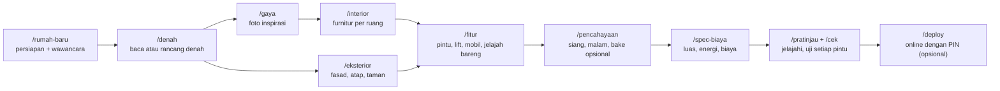

# house-3d-studio

**Rancang rumah Anda sambil mengobrol, lalu jelajahi dalam 3D di browser.**

[](https://github.com/halogass/house-3d-studio/actions/workflows/ci.yml)
[](LICENSE)


[English](README.md) · [Panduan wizard](docs/WIZARD.id.md) · [Catatan Windows](docs/WINDOWS.id.md) · [Kontribusi](CONTRIBUTING.md) · [Changelog](CHANGELOG.md)

house-3d-studio adalah template yang Anda salin satu kali untuk satu rumah. Di dalamnya, **Claude Code**
bertindak sebagai wizard yang ramah: mewawancarai Anda, membaca denah Anda (foto, scan, PDF, atau sketsa
tangan, atau merancangnya bersama Anda), menata ruang sesuai foto inspirasi, menguji bahwa setiap pintu
dan jalur bisa dilewati, lalu memberi Anda rumah 3D yang bisa dijelajahi di laptop atau HP. Bila mau,
wizard juga mengonlinekannya dengan PIN agar keluarga dan teman bisa berkunjung.

Anda tidak perlu bisa memprogram. Anda cukup mengobrol; wizard yang mengurus file.


| Tampilan dollhouse | Denah 2D |
|---|---|
|  |  |
| **Spec rumah** (luas, energi, air) | **Estimasi biaya** sesuai daerah |
|  |  |


*Semua gambar menampilkan `projects/sample-house`, rumah contoh bawaan template, dirender oleh template
ini sendiri (antarmuka dalam bahasa Inggris; wizard dan aplikasi juga tersedia dalam bahasa Indonesia).
Di kanan: rumah yang sama di HP.*

## Yang Anda dapat
- **Berjalan** ke setiap ruang (keyboard + mouse, atau sentuh di HP/tablet), tampilan **dollhouse**,
  **denah 2D**, **minimap** dengan teleport, jam dan bulan (posisi matahari).
- Opsional: pintu yang bisa dibuka, duduk di furnitur, lift rumah, mobil yang bisa dikendarai,
  **jelajah bareng online dengan suara**, angka spesifikasi (luas, energi, air), **estimasi biaya sesuai
  daerah**, **pencahayaan bake fotorealistik** (perlu kartu grafis), taman dan tapak.
- Semuanya dibangun dari file data sederhana, jadi setiap perubahan yang Anda minta langsung dibangun
  ulang dan dites ulang dalam hitungan detik.

<br clear="right">

## Cara kerjanya



Setelah setiap langkah, wizard mengubah file data rumah Anda, membangunnya ulang, memastikan setiap
pintu dan tangga bisa dilewati, lalu menunjukkan gambarnya. Anda menyetujui atau meminta perubahan
dengan bahasa sehari-hari. `/lanjut` melanjutkan dari titik terakhir, bahkan beberapa hari kemudian.

## Kebutuhan
- Laptop atau PC dengan **Windows 10/11, macOS, atau Linux**. Kartu grafis opsional (hanya untuk bake
  fotorealistik).
- **Node.js LTS**: disarankan versi 22 atau lebih baru, minimal 20.19. https://nodejs.org
- **Git**: https://git-scm.com
- **Claude Code** dengan paket Claude **Pro, Max, Team, atau Enterprise**, atau akun **Console**
  Anthropic (API). Paket Claude gratis tidak termasuk Claude Code. Panduan pemasangan:
  https://code.claude.com/docs/en/setup
- Akun GitHub gratis (untuk menyalin template) dan, hanya untuk online, akun Vercel gratis.

## Instalasi
Pasang tiga hal sekali saja: Node.js, Git, dan Claude Code. Lalu **tutup dan buka lagi terminal**.

**Windows** (PowerShell; detail dan solusi masalah di [docs/WINDOWS.id.md](docs/WINDOWS.id.md)):
```powershell
winget install OpenJS.NodeJS.LTS
winget install Git.Git
winget install Anthropic.ClaudeCode
```
Tidak ada winget? Pakai installer dari https://nodejs.org dan https://git-scm.com, lalu untuk Claude Code
jalankan `irm https://claude.ai/install.ps1 | iex` di PowerShell.

**macOS** (Terminal): pasang Node LTS dengan installer dari https://nodejs.org (atau `brew install node`),
Git dengan `xcode-select --install` (atau `brew install git`), lalu Claude Code:
```bash
curl -fsSL https://claude.ai/install.sh | bash
```
(atau `brew install --cask claude-code`).

**Linux**: Node LTS dari package manager atau [nvm](https://github.com/nvm-sh/nvm), Git dari package
manager (`sudo apt install git`), lalu Claude Code dengan perintah `curl … install.sh | bash` yang sama
seperti di macOS.

Cek (sama di semua sistem):
```
node -v
git --version
claude --version
```
`node -v` sebaiknya menampilkan v22 atau lebih tinggi (v20.19+ juga bisa).

## Mulai cepat
1. **Salin template.** Di halaman GitHub repositori ini, klik tombol hijau **Use this template** →
   **Create a new repository**. Beri nama (mis. `rumah-saya`) dan pilih **Private**: denah rumah Anda
   bersifat pribadi.
2. **Unduh salinan Anda lalu pasang** (perintah sama di PowerShell, cmd, dan bash):
   ```
   git clone https://github.com/<anda>/rumah-saya.git
   cd rumah-saya
   npm install
   ```
   Tips Windows: pakai folder pendek di luar OneDrive, mis. `C:\dev\rumah-saya`.
3. **Jalankan Claude Code** di folder itu:
   ```
   claude
   ```
   Pertama kali, Claude Code meminta Anda login dan bertanya apakah folder ini dipercaya: jawab ya.
   (Ini penting: sebelum folder dipercaya, pengaturan izin repo tidak berlaku dan setiap langkah akan meminta persetujuan.)
   File denah dan foto Anda boleh tetap di tempatnya, termasuk di folder yang namanya berspasi — wizard menyalinnya ke `projects/<rumah>/private/`.
4. Ketik **`/rumah-baru`** (atau **`/new-house`** dalam bahasa Inggris) lalu jawab pertanyaannya.
5. Kapan pun nanti: **`/lanjut`** (`/continue`) melanjutkan dari titik terakhir.

Mau lihat contoh dulu? `npm run use-project sample-house` lalu `npm run dev`, dan buka link `Local:`.

## Wizard dalam satu tabel
| Langkah | Perintah (ID / EN) | Yang Anda lakukan | Waktu |
|---|---|---|---|
| Mulai + wawancara | `/rumah-baru` · `/new-house` | menjawab ±6 kelompok pertanyaan singkat | 15–25 menit |
| Denah | `/denah` · `/floorplan` | memberi foto/PDF/sketsa denah, atau tidak; mengoreksi denah 2D | 20–60 menit |
| Gaya | `/gaya` · `/style` | memberi foto inspirasi; menyetujui gaya per ruang | 10–20 menit |
| Interior | `/interior` | menyebut kebutuhan tiap ruang; koreksi lewat chat | 15–40 menit |
| Eksterior & tapak | `/eksterior` · `/exterior` | memilih fasad, atap, taman | 10–30 menit |
| Fitur | `/fitur` · `/features` | menyalakan/mematikan fitur tambahan | 5–15 menit |
| Pencahayaan | `/pencahayaan` · `/lighting` | menyetujui siang/malam; bake hanya dengan GPU | 5 menit (+ bake) |
| Spec & biaya | `/spec-biaya` · `/spec-cost` | memberi daerah + tingkat kualitas | 10–20 menit |
| Pratinjau / cek | `/pratinjau` · `/preview`, `/cek` · `/check` | melihat dan berjalan-jalan | 2–10 menit |
| Online | `/deploy` | membuat akun Vercel, memasang PIN | 10–20 menit |
| Bantuan | `/bantuan` · `/house-help` | tidak ada | tidak ada |

Detail: [docs/WIZARD.id.md](docs/WIZARD.id.md). Anda juga boleh langsung mengetik keinginan ("dapurnya dibesarkan").

## Privasi
- Denah dan foto Anda tetap di komputer Anda, di `projects/<rumah>/private/`. Folder itu tercantum di
  `.gitignore` dan `.vercelignore`, jadi tidak pernah masuk git dan tidak pernah di-deploy.
- Wizard tidak pernah menanyakan alamat, nama keluarga, atau detail keamanan, dan tidak pernah
  mengunggah foto Anda.
- **Simpan salinan repositori Anda sebagai Private di GitHub** begitu berisi rumah Anda yang sebenarnya:
  file data (`projects/<rumah>/`) menggambarkan tata letaknya. Siapa pun yang punya link situs **dan** PIN
  juga bisa melihatnya, jadi bagikan PIN dengan hati-hati.
- Foto hanya dijadikan tekstur bila Anda mengonfirmasi bahwa Anda memotretnya sendiri atau punya izin.
- PIN dan kunci Anda ketik sendiri di Vercel; tidak pernah disimpan di repositori atau di chat.
  Claude Code diatur agar tidak bisa membaca file `.env` Anda dan wajib bertanya sebelum men-deploy.

## Catatan GPU
Semua fitur jalan di laptop biasa dengan grafis bawaan. **Bake fotorealistik** bersifat opsional dan
butuh kartu grafis sungguhan (mis. NVIDIA GTX 1060 / RTX, AMD RX 5000+, atau Apple M-series untuk rumah
kecil); prosesnya 10 menit sampai 2 jam. HP dan tablet otomatis memakai kualitas yang lebih ringan.

## Mengonlinekan
`/deploy` memandu Anda, dan Claude Code selalu meminta persetujuan Anda sebelum mengunggah:
- **Vercel** (akun gratis) menjadi tempat situsnya. Anda login sekali dari komputer.
- **PIN (opsional, disarankan):** isi `SITE_PIN` dan `SITE_SECRET` di Environment Variables proyek
  Vercel Anda; pengunjung lalu perlu PIN. Tanpa itu situsnya publik.
- **Jelajah bareng (opsional):** tambahkan kunci proyek **Supabase** gratis milik Anda sendiri. Tanpa itu
  menu multiplayer tetap jalan antar-tab di satu browser. Lihat [.env.example](.env.example).
- Di akhir, wizard membuka situs online dan memastikan semuanya berjalan.

## Perintah yang berguna
Jarang perlu (wizard yang menjalankannya), tapi sama di PowerShell, cmd, dan bash:

| Perintah | Fungsi |
|---|---|
| `npm run dev` | menjalankan rumah di komputer (buka link `Local:`; link `Network:` bisa dibuka di HP pada Wi-Fi yang sama) |
| `npm run validate` / `npm run check` / `npm test` | cek data, lewati setiap pintu, jalankan tes |
| `npm run new-project <nama>` / `npm run use-project <nama>` | rumah baru / pindah rumah |
| `npm run build` / `npm run preview` | build produksi / pratinjau hasilnya |
| `npm run screenshots` | gambar setiap ruang ke `projects/<rumah>/shots/` |

## Tanya jawab
**Perlu bisa coding?** Tidak. Anda mengobrol; wizard yang mengubah dan menguji file.

**Apakah berbayar?** Template ini gratis (MIT). Anda perlu Claude Code (paket Claude berbayar atau
pemakaian API). Paket gratis Vercel dan Supabase cukup untuk rumah keluarga.

**Denah saya cuma foto HP yang buram.** Biasanya tetap bisa. Wizard membaca angka ukuran atau benda yang
ukurannya diketahui (pintu, kasur) untuk mencari skala, dan menanyakan bagian yang tidak jelas. Foto yang
lurus dan terang sangat membantu.

**Saya tidak punya denah.** Pilih "tidak ada denah"; wizard merancang dua alternatif dari jawaban Anda.

**Bisa mengedit dengan menarik dinding?** Belum. Koreksi dilakukan lewat chat, dan setiap kali Anda
mendapat denah 2D dan gambar baru.

**Apakah estimasi biaya itu penawaran harga?** Bukan. Itu estimasi perencanaan dengan rentang, disesuaikan
dengan daerah Anda. Tanyakan ke kontraktor atau QS setempat sebelum memutuskan.

**Windows: "running scripts is disabled on this system".** PowerShell memblokir `npm` sampai Anda
mengizinkan skrip lokal sekali: `Set-ExecutionPolicy -Scope CurrentUser RemoteSigned`. Atau ketik
`npm.cmd` sebagai ganti `npm`, atau pakai Command Prompt (cmd). Lihat
[docs/WINDOWS.id.md](docs/WINDOWS.id.md#execution-policy-powershell).

**Windows: "Filename too long" atau error jauh di dalam `node_modules`.** Taruh proyek di folder pendek
seperti `C:\dev\rumah-saya` (bukan di OneDrive atau path Documents yang panjang). Bila masih terjadi,
aktifkan long paths: lihat [docs/WINDOWS.id.md](docs/WINDOWS.id.md#path-panjang).

**Laptop saya tua / tidak punya kartu grafis.** Tidak masalah. Grafis bawaan (Intel, AMD, Apple) cukup
untuk jelajah 3D; hanya bake fotorealistik yang perlu GPU sungguhan. Di laptop yang sangat tua pilih
kualitas **Ringan** di menu Opsi. Bila tampilan 3D tetap hitam, perbarui driver grafis dan pastikan
"Use graphics acceleration" aktif di pengaturan browser (Chrome/Edge → Settings → System); halaman ini
butuh WebGL 2, yang didukung Chrome, Edge, Firefox, dan Safari versi terbaru. Cek di
https://get.webgl.org/webgl2/.

**Apakah jalan di tablet atau HP?** Ya: buka link `Network:` dari `npm run dev` di Wi-Fi yang sama, atau
link online Anda. Kontrol sentuh muncul otomatis dan kualitas menyesuaikan perangkat. Bila tablet lama
lambat atau hitam, pilih kualitas **Ringan** di menu Opsi; lihat
[pemecahan masalah di CLAUDE.md](CLAUDE.md#8-troubleshooting). Merancang (wizard) perlu komputer.

**Bisa merancang dua rumah?** Paling mudah satu salinan untuk satu rumah. Untuk rumah kedua, buat salinan
template lagi.

**Bagaimana mendapat pembaruan template?** Perubahan engine bisa ditarik dari repositori template dengan
git; minta bantuan Claude Code ("perbarui engine dari template").

## Lisensi dan kredit
MIT, lihat [LICENSE](LICENSE). Dibuat dengan [three.js](https://threejs.org), [Vite](https://vite.dev),
[sharp](https://sharp.pixelplumbing.com), [Playwright](https://playwright.dev), opsional
[Supabase](https://supabase.com) dan [Vercel](https://vercel.com). Tekstur dan environment map berlisensi
CC0 (lihat file kredit di `public/`). Wizard berjalan di [Claude Code](https://code.claude.com) buatan
Anthropic. Masalah keamanan: lihat [SECURITY.md](SECURITY.md).
