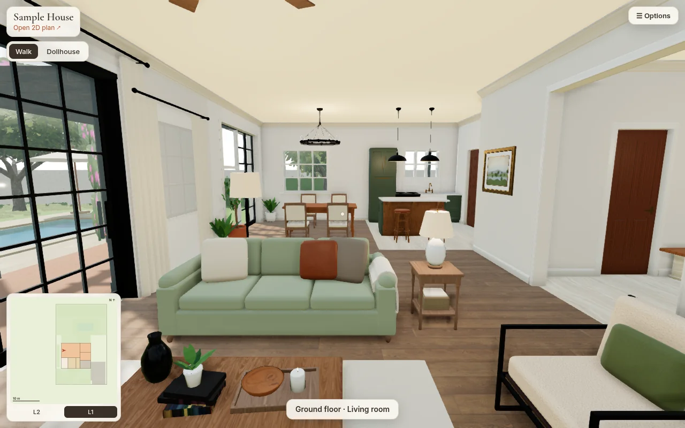
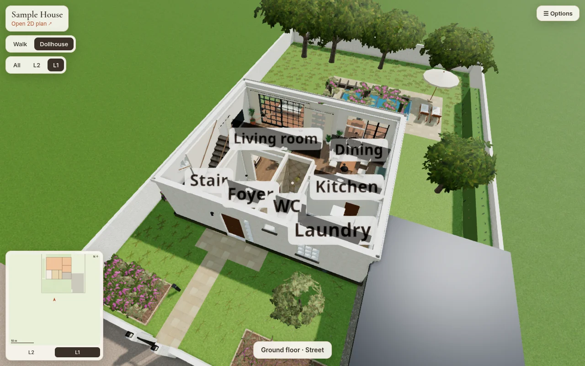
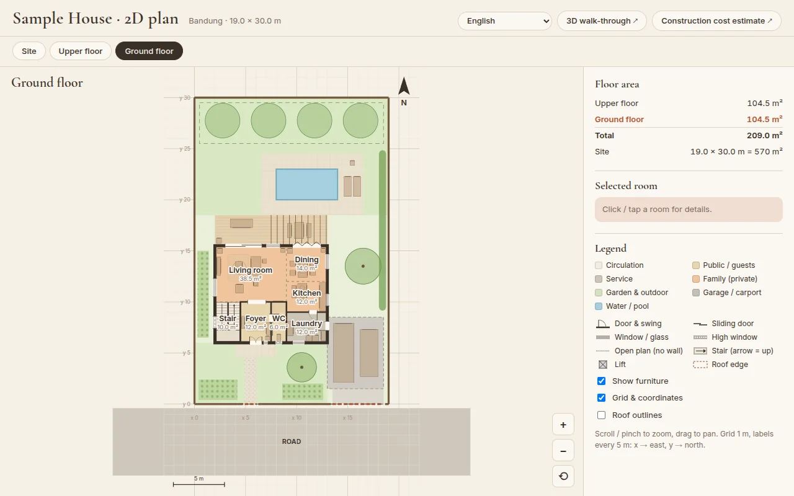
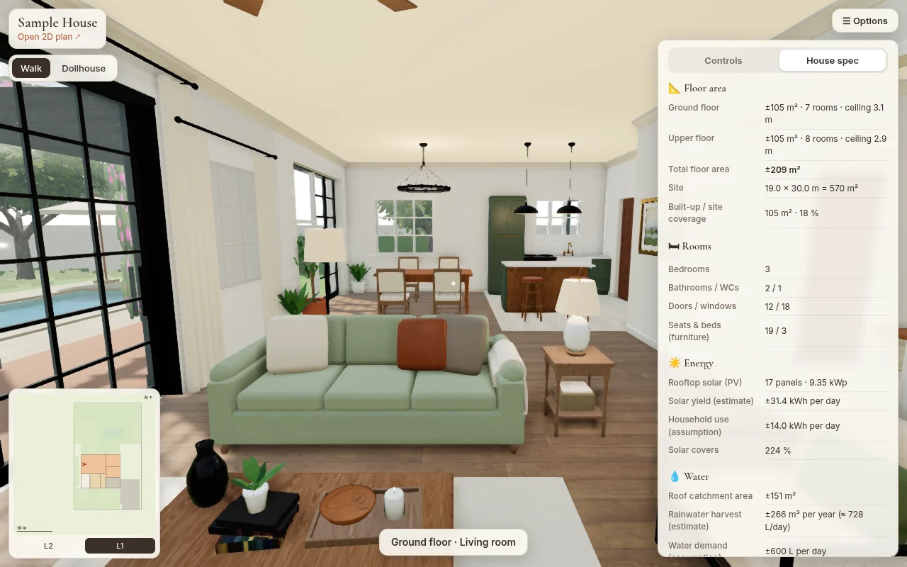
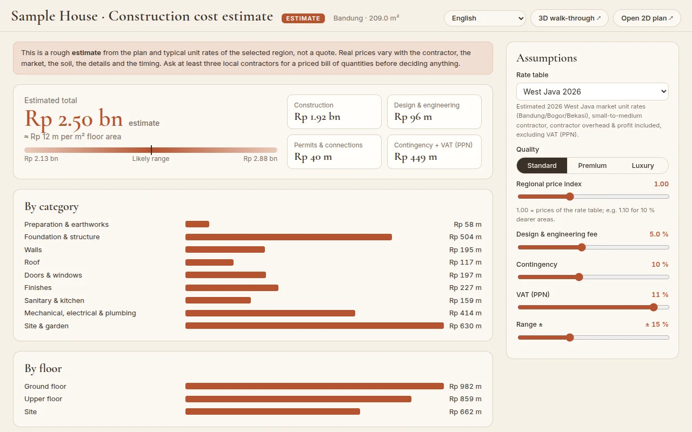
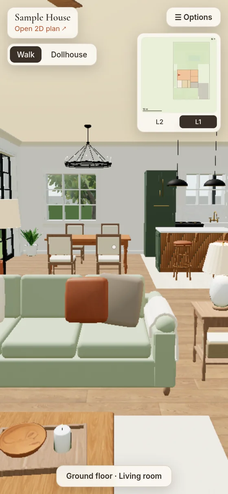
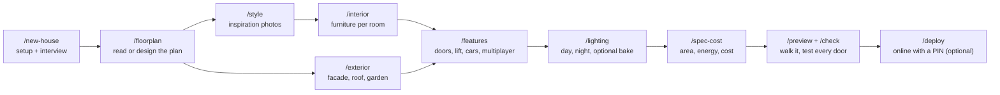

# house-3d-studio

**Design your house by chatting, then walk through it in 3D in your browser.**

[](https://github.com/OWNER/house-3d-studio/actions/workflows/ci.yml)
[](LICENSE)


[Bahasa Indonesia](README.id.md) · [Wizard guide](docs/WIZARD.md) · [Windows notes](docs/WINDOWS.md) · [Contributing](CONTRIBUTING.md) · [Changelog](CHANGELOG.md)

house-3d-studio is a template you copy once per house. Inside it, **Claude Code** acts as a friendly
wizard: it interviews you, reads your floor plan (a photo, a scan, a PDF or a hand sketch, or designs one
with you), dresses the rooms in the style of your inspiration photos, tests that every door and route
works, and gives you a 3D house you can walk through on a laptop or phone. If you like, it puts it online
behind a PIN so family and friends can visit.

You don't need to be a programmer. You talk; the wizard does the files.



| Dollhouse view | 2D plan |
|---|---|
|  |  |
| **House spec** (area, energy, water) | **Cost estimate** for your region |
|  |  |



*All pictures show `projects/sample-house`, the example that comes with the template, rendered by the
template itself. On the right: the same house on a phone.*

## What you get
- **Walk** through every room (keyboard + mouse, or touch on a phone/tablet), **dollhouse** view,
  **2D plan**, **minimap** with teleport, time of day and month (sun position).
- Optional: doors that open, sitting on furniture, a home lift, drivable cars, **walking together online
  with voice**, spec numbers (area, energy, water), a **regional cost estimate**, **photoreal baked
  lighting** (needs a graphics card), garden and site.
- Everything is generated from simple data files, so any change you ask for is rebuilt and re-tested in
  seconds.

<br clear="right">

## How it works



After each step the wizard changes the data files of your house, rebuilds it, checks that every door
and stair can be walked, and shows you pictures. You approve or ask for changes in plain words.
`/continue` picks up wherever you stopped, even days later.

## Requirements
- A laptop or desktop with **Windows 10/11, macOS or Linux**. A graphics card is optional (only for the
  photoreal bake).
- **Node.js LTS**: version 22 or newer recommended, 20.19 at the least. https://nodejs.org
- **Git**: https://git-scm.com
- **Claude Code** with a Claude **Pro, Max, Team or Enterprise** plan, or an Anthropic **Console** (API)
  account. The free Claude plan does not include Claude Code. Setup guide:
  https://code.claude.com/docs/en/setup
- A free GitHub account (to copy the template) and, only to put the house online, a free Vercel account.

## Install
Install three things once: Node.js, Git and Claude Code. Then **close and reopen the terminal**.

**Windows** (PowerShell; details and fixes in [docs/WINDOWS.md](docs/WINDOWS.md)):
```powershell
winget install OpenJS.NodeJS.LTS
winget install Git.Git
winget install Anthropic.ClaudeCode
```
No winget? Use the installers from https://nodejs.org and https://git-scm.com, and for Claude Code run
`irm https://claude.ai/install.ps1 | iex` in PowerShell.

**macOS** (Terminal): install Node LTS with the installer from https://nodejs.org (or `brew install node`),
Git with `xcode-select --install` (or `brew install git`), then Claude Code:
```bash
curl -fsSL https://claude.ai/install.sh | bash
```
(or `brew install --cask claude-code`).

**Linux**: Node LTS from your package manager or [nvm](https://github.com/nvm-sh/nvm), Git from your
package manager (`sudo apt install git`), then Claude Code with the same `curl … install.sh | bash`
command as on macOS.

Check (same on every system):
```
node -v
git --version
claude --version
```
`node -v` should print v22 or higher (v20.19+ also works).

## Quick start
1. **Copy the template.** On this repository's GitHub page, click the green **Use this template** button
   → **Create a new repository**. Give it a name (e.g. `my-house`) and choose **Private**: your floor plan
   is personal.
2. **Download your copy and install** (same commands in PowerShell, cmd and bash):
   ```
   git clone https://github.com/<you>/my-house.git
   cd my-house
   npm install
   ```
   Windows tip: use a short folder outside OneDrive, e.g. `C:\dev\my-house`.
3. **Start Claude Code** in that folder:
   ```
   claude
   ```
   The first time, Claude Code asks you to log in and whether you trust this folder: say yes.
   (This matters: until the folder is trusted, the repo's permission settings don't apply and every step asks for approval.)
   Your plan and photo files can stay where they are, even in folders with spaces — the wizard copies them into `projects/<house>/private/`.
4. Type **`/new-house`** (or **`/rumah-baru`** in Indonesian) and answer the questions.
5. Any time later: **`/continue`** (`/lanjut`) picks up where you stopped.

Want to look first? `npm run use-project sample-house` then `npm run dev`, and open the `Local:` link.

## The wizard in one table
| Step | Command (EN / ID) | You do | Takes |
|---|---|---|---|
| Start + interview | `/new-house` · `/rumah-baru` | answer ~6 short batches of questions | 15–25 min |
| Floor plan | `/floorplan` · `/denah` | give a plan photo/PDF/sketch, or none; correct the 2D plan | 20–60 min |
| Style | `/style` · `/gaya` | give inspiration photos; approve the style per room | 10–20 min |
| Interior | `/interior` | say what each room needs; correct by chat | 15–40 min |
| Exterior & site | `/exterior` · `/eksterior` | pick façade, roof, garden | 10–30 min |
| Features | `/features` · `/fitur` | switch extras on/off | 5–15 min |
| Lighting | `/lighting` · `/pencahayaan` | approve day/night; bake only with a GPU | 5 min (+ bake) |
| Spec & cost | `/spec-cost` · `/spec-biaya` | give region + quality | 10–20 min |
| Preview / check | `/preview` · `/pratinjau`, `/check` · `/cek` | look and walk | 2–10 min |
| Put online | `/deploy` | create a Vercel account, set a PIN | 10–20 min |
| Help | `/house-help` · `/bantuan` | n/a | n/a |

Details: [docs/WIZARD.md](docs/WIZARD.md). You can also just type what you want ("make the kitchen bigger").

## Privacy
- Your plans and photos stay on your computer in `projects/<house>/private/`. That folder is listed in
  `.gitignore` and `.vercelignore`, so it is never committed to git and never deployed.
- The wizard never asks for your address, family names or security details, and never uploads your photos.
- **Keep your copy of the repository Private on GitHub** once it contains your real house: the data files
  (`projects/<house>/`) describe its layout. Anyone with your site link **and** PIN can also see it, so
  share the PIN carefully.
- Photos become textures only if you confirm you took them or may use them.
- PINs and keys are typed into Vercel by you; they are never stored in the repository or the chat.
  Claude Code is set up so it cannot read your `.env` files and must ask you before it deploys anything.

## GPU note
Everything works on a normal laptop with built-in graphics. The **photoreal bake** is optional and needs a
real graphics card (e.g. NVIDIA GTX 1060 / RTX, AMD RX 5000+, or Apple M-series for small houses); it takes
10 minutes to 2 hours. Phones and tablets get a lighter quality level automatically.

## Putting it online
`/deploy` walks you through it, and Claude Code always asks for your OK before uploading:
- **Vercel** (free account) hosts the site. You log in once from your computer.
- **PIN (optional, recommended):** set `SITE_PIN` and `SITE_SECRET` in your Vercel project's
  Environment Variables; visitors then need the PIN. Without them the site is public.
- **Walking together (optional):** add the keys of your own free **Supabase** project. Without them the
  multiplayer menu still works between tabs of one browser. See [.env.example](.env.example).
- At the end the wizard opens the live site and checks that it works.

## Useful commands
You rarely need these (the wizard runs them), but they work the same in PowerShell, cmd and bash:

| Command | What |
|---|---|
| `npm run dev` | run the house locally (open the `Local:` link; the `Network:` link works on your phone on the same Wi-Fi) |
| `npm run validate` / `npm run check` / `npm test` | check data, walk every door, run tests |
| `npm run new-project <name>` / `npm run use-project <name>` | new house / switch house |
| `npm run build` / `npm run preview` | production build / preview it |
| `npm run screenshots` | pictures of every room into `projects/<house>/shots/` |

## FAQ
**Do I need to know how to code?** No. You chat; the wizard edits and tests the files.

**Does it cost money?** The template is free (MIT). You need Claude Code (a paid Claude plan or API usage).
Vercel and Supabase free tiers are enough for a family house.

**My plan is a blurry phone photo.** Usually fine. The wizard reads dimension labels or known sizes (doors,
beds) to find the scale and asks about anything unclear. A straight, well-lit photo helps.

**I have no plan.** Choose "no plan"; the wizard designs two layouts from your answers.

**Can I edit by dragging walls?** Not yet. Corrections are made by chat, and you see a new 2D plan and
pictures each time.

**Is the cost estimate a quote?** No. It is a planning estimate with a range, adapted to your region. Ask
a local contractor or quantity surveyor before deciding.

**Windows says "running scripts is disabled on this system".** PowerShell blocks `npm` until you allow
local scripts once: `Set-ExecutionPolicy -Scope CurrentUser RemoteSigned`. Or type `npm.cmd` instead of
`npm`, or use the Command Prompt (cmd). See [docs/WINDOWS.md](docs/WINDOWS.md#powershell-execution-policy).

**Windows: "Filename too long" or errors deep inside `node_modules`.** Put the project in a short folder
such as `C:\dev\my-house` (not in OneDrive or a long Documents path). If it still happens, enable long
paths: see [docs/WINDOWS.md](docs/WINDOWS.md#long-paths).

**My laptop is old / has no graphics card.** You don't need one. Built-in graphics (Intel, AMD, Apple)
run the walk-through; only the optional photoreal bake needs a real GPU. On a very old laptop choose
**Light** quality in Options. If the 3D view stays black, update the graphics driver and make sure
"Use graphics acceleration" is on in your browser's settings (Chrome/Edge → Settings → System); the
page needs WebGL 2, which current versions of Chrome, Edge, Firefox and Safari all support. Check at
https://get.webgl.org/webgl2/.

**Does it work on a tablet or phone?** Yes: open the `Network:` link from `npm run dev` on the same
Wi-Fi, or your online link. Touch controls appear automatically and the quality drops to fit the device.
If an older tablet is slow or black, choose **Light** quality in Options; see
[troubleshooting in CLAUDE.md](CLAUDE.md#8-troubleshooting). Designing (the wizard) needs a computer.

**Can I design two houses?** One copy per house is simplest. For a second house, make another copy of the
template.

**How do I get template updates?** Changes to the engine can be pulled in from the template repository
with git; ask Claude Code to help ("update the engine from the template").

## Licence and credits
MIT, see [LICENSE](LICENSE). Built with [three.js](https://threejs.org), [Vite](https://vite.dev),
[sharp](https://sharp.pixelplumbing.com), [Playwright](https://playwright.dev), optional
[Supabase](https://supabase.com) and [Vercel](https://vercel.com). Textures and environment maps are CC0
(see the credits files under `public/`). The wizard runs on [Claude Code](https://code.claude.com) by
Anthropic. Security issues: see [SECURITY.md](SECURITY.md).
